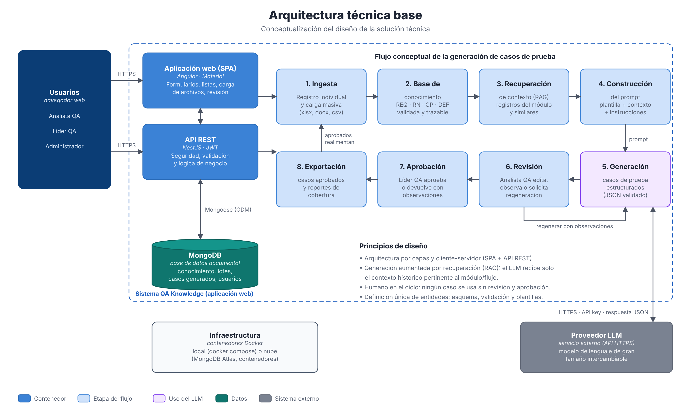
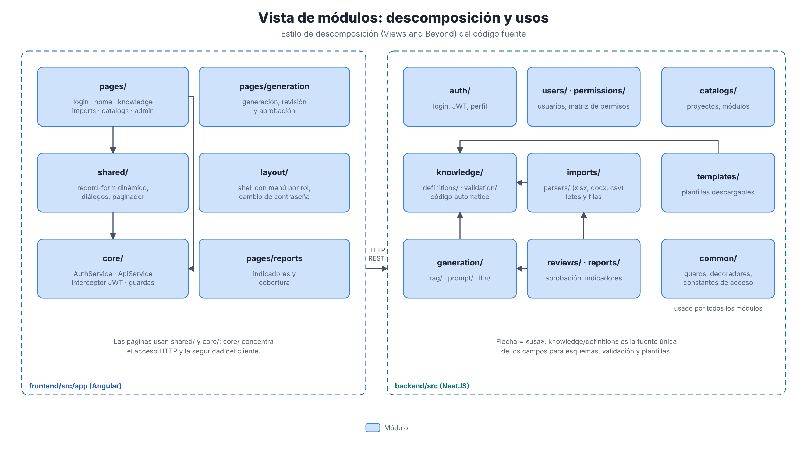
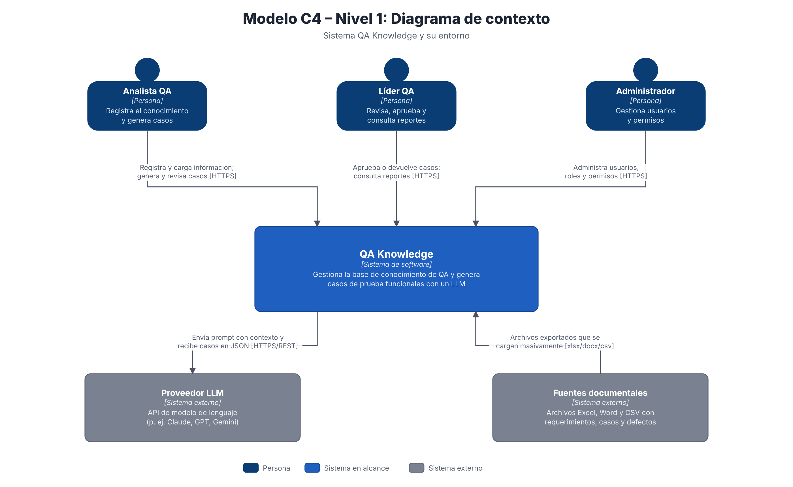
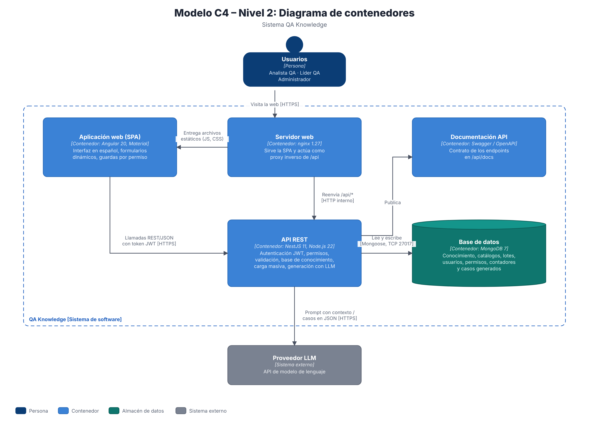
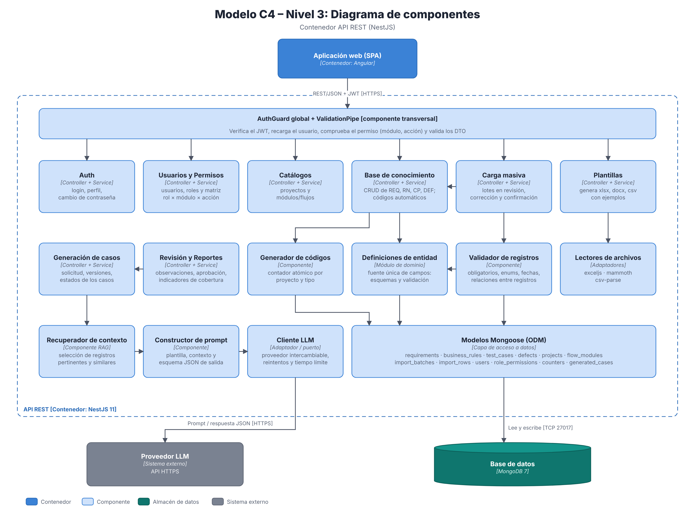
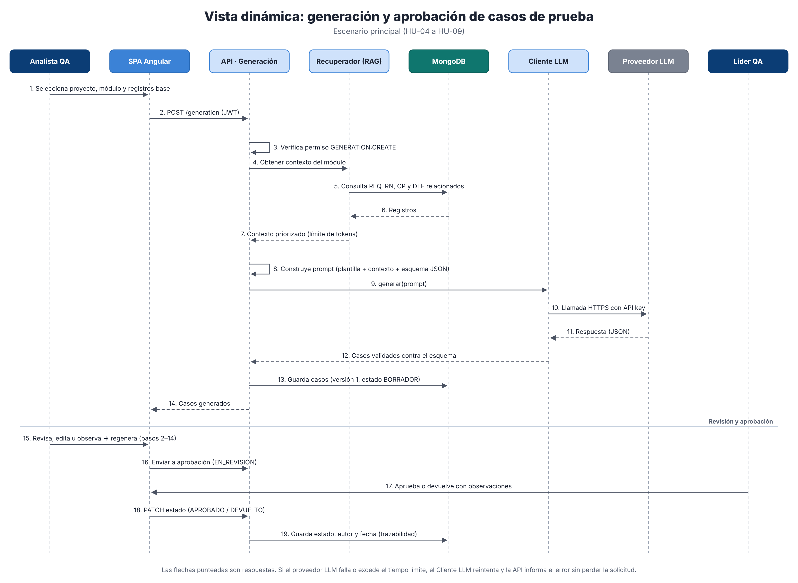
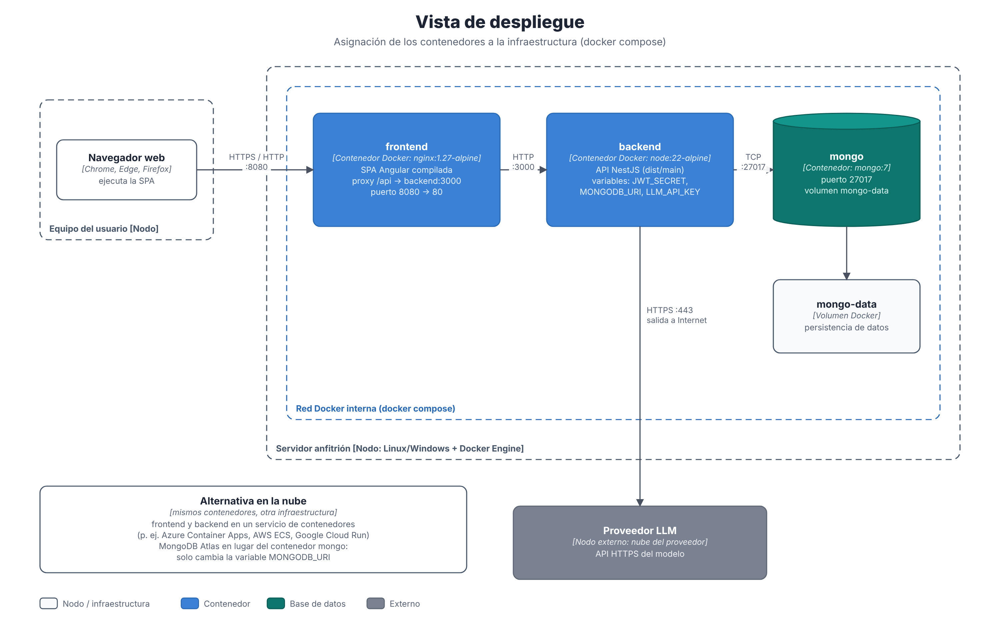

# 3.3 Arquitectura técnica

Este documento desarrolla los puntos 3.3.1 y 3.3.2 del informe para el sistema **QA Knowledge**: un sistema web
basado en LLM para generar casos de prueba funcionales en el flujo de compra de monedas virtuales en videojuegos en
línea. Las figuras están en [`docs/figuras/`](figuras/), en formato SVG (editable) y PNG (para insertar en el informe).

---

## 3.3.1 Arquitectura técnica base (conceptualización del diseño de la solución técnica)

### Descripción general

La solución es una **aplicación web cliente-servidor organizada por capas**. El usuario trabaja desde el navegador
con una aplicación de página única (SPA). La SPA consume una API REST que concentra la seguridad, la validación y la
lógica de negocio. La información se guarda en una base de datos documental. La generación de casos sigue el patrón
**generación aumentada por recuperación (RAG, *Retrieval-Augmented Generation*)**: antes de llamar al modelo de
lenguaje, el sistema recupera de la base de conocimiento los requerimientos, reglas de negocio, casos de prueba y
defectos del módulo o flujo elegido. Con ellos arma el *prompt*, de modo que el LLM genera casos a partir del
conocimiento real del equipo de QA y no solo de su conocimiento general.



*Figura 3.x. Arquitectura técnica base: conceptualización del diseño de la solución.*

### Flujo conceptual de la solución

| Paso | Etapa | Descripción |
|---|---|---|
| 1 | Ingesta | Registro individual con formularios y carga masiva desde Excel, Word y CSV, con un lote en revisión antes de guardar. |
| 2 | Base de conocimiento | Requerimientos (REQ), reglas de negocio (RN), casos de prueba (CP) y defectos (DEF) validados, con código automático, relaciones entre registros y origen (archivo y lote). |
| 3 | Recuperación de contexto | Selección de los registros del proyecto y módulo/flujo, más los relacionados y similares, hasta el límite de tokens del modelo. |
| 4 | Construcción del *prompt* | Plantilla de instrucciones, contexto recuperado, técnicas de diseño pedidas (partición de equivalencia, valores límite, tabla de decisión, etc.) y esquema JSON de salida. |
| 5 | Generación con LLM | Llamada HTTPS al proveedor del LLM. La respuesta se valida contra el esquema antes de mostrarla. |
| 6 | Revisión | El Analista QA edita los casos, registra observaciones o pide una regeneración con esas observaciones. |
| 7 | Aprobación | El Líder QA aprueba los casos o los devuelve con observaciones. Cada cambio de estado guarda su autor y fecha. |
| 8 | Exportación y reportes | Exportación de los casos aprobados e indicadores de cobertura. Los casos aprobados vuelven a la base de conocimiento. |

### Componentes de la solución

| Elemento | Tecnología | Responsabilidad |
|---|---|---|
| Aplicación web (capa de presentación) | Angular 20 + Angular Material | Interfaz en español, menú según el rol, formularios dinámicos, carga de archivos y revisión de lotes. |
| API REST (capas de servicios y negocio) | NestJS 11 sobre Node.js 22 (TypeScript) | Autenticación JWT, autorización por rol y módulo, validación, base de conocimiento, carga masiva, plantillas, generación con LLM, revisión, aprobación y reportes. |
| Capa de integración | exceljs, mammoth, csv-parse; cliente HTTP del LLM | Lectura de archivos, recuperación de contexto y comunicación con el proveedor del LLM. |
| Base de datos | MongoDB 7 (Mongoose como ODM) | Almacenamiento documental de la base de conocimiento, catálogos, lotes, usuarios, permisos y casos generados. |
| Proveedor LLM | API externa por HTTPS (modelo intercambiable) | Generación del texto de los casos de prueba a partir del *prompt*. |
| Infraestructura | Docker y docker compose (local) o servicios de contenedores en la nube con MongoDB Atlas | Despliegue reproducible del sistema. |

### Decisiones técnicas base

| Decisión | Alternativas evaluadas | Justificación |
|---|---|---|
| Aplicación web SPA + API REST | Aplicación de escritorio; web renderizada en el servidor | Acceso sin instalación para el equipo de QA. El contrato REST (documentado con OpenAPI) separa la interfaz de la lógica. |
| TypeScript en el frontend y el backend | Java/Spring, Python/Django | Un solo lenguaje en todo el sistema y tipado estático. NestJS ofrece módulos, inyección de dependencias y guardas, lo que da una estructura por capas clara. |
| MongoDB (documental) | PostgreSQL (relacional) | Los registros tienen estructuras variables (pasos, listas de criterios, referencias múltiples) y se envían al LLM como JSON. El modelo documental evita transformaciones y deja ampliar campos sin migraciones. |
| RAG en lugar de reentrenar el modelo | *Fine-tuning* de un modelo | No necesita grandes volúmenes de datos ni infraestructura de entrenamiento. El conocimiento se actualiza en cuanto se registra y el contexto usado queda trazado. |
| LLM como servicio externo detrás de un adaptador | Modelo local (*self-hosted*) | Mejor calidad sin GPU propia. El adaptador permite cambiar de proveedor o usar un modelo local sin tocar la lógica de negocio. |
| Humano en el ciclo (revisión y aprobación) | Uso directo de lo generado | El LLM puede producir casos incorrectos o incompletos (alucinaciones). Ningún caso se usa sin revisión del Analista QA y aprobación del Líder QA. |
| Definición única de entidades | Esquemas, validaciones y plantillas por separado | Un solo archivo (`entity-definitions.ts`) genera esquemas, validación, plantillas y formularios. Así se evitan inconsistencias. |
| Contenedores Docker | Instalación manual | El mismo artefacto se ejecuta en local y en la nube. Pasar a la nube solo exige cambiar variables de entorno. |

La arquitectura por capas con sus componentes internos se detalla en la figura
[`arquitectura-componentes.png`](figuras/arquitectura-componentes.png), y el flujo funcional en
[`flujo-funcional.png`](figuras/flujo-funcional.png).

---

## 3.3.2 Arquitectura técnica específica

### A. Atributos de calidad de software

Los atributos de calidad se definieron con el enfoque de Bass, Clements y Kazman (*Software Architecture in Practice*,
4.ª ed.). Cada atributo se expresa como un **escenario de calidad** de seis partes (fuente, estímulo, artefacto,
entorno, respuesta y medida de la respuesta) y se asocia a las **tácticas** arquitectónicas que lo satisfacen. Los
atributos salen de los requerimientos técnicos del producto (Product Canvas: control de acceso por roles,
validación de datos antes de guardarlos, trazabilidad del origen de cada registro, despliegue local o en la nube) y
de las restricciones de la sección A.3.

#### A.1 Árbol de utilidad (priorización)

Prioridad expresada como (importancia para el negocio, dificultad técnica): A = alta, M = media, B = baja.

| Atributo | Refinamiento | Escenario | Prioridad |
|---|---|---|---|
| Seguridad | Confidencialidad y autorización | ESC-01 Acceso no autorizado a un módulo | (A, M) |
| Seguridad | No repudio y trazabilidad | ESC-02 Trazabilidad de registros y aprobaciones | (A, B) |
| Integridad de datos | Validación de la entrada | ESC-03 Carga masiva con datos inválidos | (A, M) |
| Modificabilidad | Cambio de proveedor LLM | ESC-04 Sustitución del modelo de lenguaje | (A, A) |
| Modificabilidad | Cambio en la estructura de datos | ESC-05 Nuevo campo en un tipo de registro | (M, B) |
| Disponibilidad | Tolerancia a fallas del servicio externo | ESC-06 El proveedor LLM no responde | (A, A) |
| Rendimiento | Tiempo de respuesta | ESC-07 Consultas y generación de casos | (M, M) |
| Usabilidad | Facilidad de aprendizaje y prevención de errores | ESC-08 Corrección de errores en la carga masiva | (A, B) |
| Desplegabilidad (portabilidad) | Cambio de entorno | ESC-09 Despliegue en la nube | (M, B) |
| Calidad de la salida del LLM | Corrección del resultado | ESC-10 Respuesta del LLM mal estructurada | (A, A) |

#### A.2 Escenarios de calidad

**ESC-01 Seguridad: acceso no autorizado**

| Parte | Descripción |
|---|---|
| Fuente | Usuario autenticado con rol Analista QA, o cliente sin token |
| Estímulo | Intenta eliminar un registro o entrar a la administración de usuarios |
| Artefacto | API REST (endpoints protegidos) y rutas de la SPA |
| Entorno | Operación normal |
| Respuesta | El sistema rechaza la petición (401 sin sesión válida, 403 sin permiso), no modifica datos y oculta la opción en el menú |
| Medida | 100 % de los endpoints no públicos exigen JWT válido y permiso (módulo, acción). Un cambio de rol o una desactivación se aplica en la siguiente petición |
| Tácticas | Autenticar actores (JWT firmado, expira en 8 h); autorizar actores (guarda global `AuthGuard` con matriz rol × módulo × acción configurable); limitar la exposición (guardas de ruta en la SPA); contraseñas con hash bcrypt; secretos en variables de entorno |

**ESC-02 Seguridad: trazabilidad**

| Parte | Descripción |
|---|---|
| Fuente | Líder QA o auditor interno |
| Estímulo | Necesita saber quién registró, cargó, modificó o aprobó un registro o caso, y de dónde vino |
| Artefacto | Base de conocimiento, lotes de carga y casos generados |
| Entorno | Operación normal |
| Respuesta | El sistema muestra el autor, las fechas de creación y modificación, el archivo y lote de origen y, para los casos generados, la versión, el estado y quién lo aprobó |
| Medida | 100 % de los registros guardan usuario y marcas de tiempo; 100 % de los registros cargados guardan archivo y lote de origen |
| Tácticas | Mantener un registro de auditoría (`timestamps`, `createdBy`, origen); versionado de los casos generados |

**ESC-03 Integridad de datos: carga masiva con datos inválidos**

| Parte | Descripción |
|---|---|
| Fuente | Analista QA |
| Estímulo | Sube un archivo Excel, Word o CSV con campos obligatorios vacíos, valores no permitidos, fechas incorrectas o referencias inexistentes |
| Artefacto | Componente de carga masiva y validador de registros |
| Entorno | Operación normal, archivos de hasta 10 MB, hasta 10 archivos y 5000 filas por lote |
| Respuesta | El sistema crea un lote en revisión, marca cada fila como válida, con advertencias o con errores, y no guarda en la base de conocimiento ninguna fila con errores |
| Medida | 0 registros inválidos guardados; cada error indica fila, campo y motivo |
| Tácticas | Validar la entrada (DTO + `ValidationPipe` + validador por definición de entidad); área de preparación (*staging*) con confirmación explícita; límites de tamaño y cantidad |

**ESC-04 Modificabilidad: sustitución del proveedor LLM**

| Parte | Descripción |
|---|---|
| Fuente | Equipo de desarrollo |
| Estímulo | Hay que cambiar de modelo o proveedor (costo, calidad o disponibilidad) |
| Artefacto | Componente Cliente LLM |
| Entorno | Tiempo de diseño y despliegue |
| Respuesta | Se implementa o configura un nuevo adaptador sin cambiar la generación, la revisión ni la interfaz |
| Medida | Cambio limitado a un módulo (`generation/llm`) y a variables de entorno; hasta 1 día de trabajo |
| Tácticas | Encapsular y usar un intermediario (patrón puerto/adaptador); configuración diferida (proveedor, modelo y clave por variables de entorno); salida definida por un esquema JSON independiente del proveedor |

**ESC-05 Modificabilidad: nuevo campo en un tipo de registro**

| Parte | Descripción |
|---|---|
| Fuente | Líder QA (nuevo requerimiento) |
| Estímulo | Pide añadir un campo, por ejemplo "Plataforma" en los defectos |
| Artefacto | Definiciones de entidad |
| Entorno | Tiempo de desarrollo |
| Respuesta | El campo aparece en el esquema, la validación, las plantillas descargables y el formulario |
| Medida | Un solo archivo modificado (`entity-definitions.ts`), sin migración de datos |
| Tácticas | Aumentar la cohesión y reducir el acoplamiento (fuente única de definición); diseño dirigido por metadatos |

**ESC-06 Disponibilidad: el proveedor LLM no responde**

| Parte | Descripción |
|---|---|
| Fuente | Proveedor LLM (sistema externo) |
| Estímulo | Tiempo de espera agotado, error 5xx o límite de uso (429) |
| Artefacto | Cliente LLM y componente de generación |
| Entorno | Operación normal |
| Respuesta | El sistema reintenta con espera exponencial, informa al usuario con un mensaje claro y guarda la solicitud para repetirla. La base de conocimiento y el resto de módulos siguen operando |
| Medida | Hasta 3 reintentos; el usuario recibe respuesta en ≤ 90 s; 0 % de pérdida de la información de la solicitud |
| Tácticas | Detectar fallas (*timeout*); recuperarse (reintento con espera exponencial); degradación controlada (los módulos sin LLM no dependen del proveedor) |

**ESC-07 Rendimiento: consultas y generación**

| Parte | Descripción |
|---|---|
| Fuente | Hasta 20 usuarios concurrentes del área de QA |
| Estímulo | Búsquedas en la base de conocimiento y solicitudes de generación |
| Artefacto | API REST y MongoDB |
| Entorno | Operación normal con hasta 10 000 registros por proyecto |
| Respuesta | Listados paginados y búsquedas filtradas; generación con indicador de progreso |
| Medida | Consultas en ≤ 2 s (percentil 95); generación de un lote de casos en ≤ 60 s |
| Tácticas | Índices (proyecto, módulo, código); paginación en el servidor; limitar el contexto enviado al LLM (priorización y límite de tokens); carga diferida de páginas en la SPA (*lazy loading*) |

**ESC-08 Usabilidad: corrección de errores en la carga masiva**

| Parte | Descripción |
|---|---|
| Fuente | Analista QA sin experiencia previa en el sistema |
| Estímulo | Necesita corregir las filas con errores de un lote |
| Artefacto | Pantallas de revisión de lotes |
| Entorno | Tiempo de ejecución |
| Respuesta | El sistema muestra las filas por estado con colores, permite corregir cada una en un formulario, revalida al instante y deja excluir las filas no deseadas |
| Medida | Corregir una fila toma ≤ 1 minuto; se pueden descargar plantillas con ejemplos válidos |
| Tácticas | Soporte a la iniciativa del usuario (corregir, excluir, cancelar); modelo del usuario (interfaz en español, plantillas con ejemplos, códigos automáticos, listas con buscador para elegir registros relacionados) |

**ESC-09 Desplegabilidad: despliegue en la nube**

| Parte | Descripción |
|---|---|
| Fuente | Administrador de TI |
| Estímulo | Hay que mover el sistema de un entorno local a la nube |
| Artefacto | Contenedores frontend, backend y base de datos |
| Entorno | Tiempo de despliegue |
| Respuesta | Las mismas imágenes Docker se ejecutan en el nuevo entorno cambiando solo variables de entorno |
| Medida | Sin cambios de código; despliegue en ≤ 1 hora |
| Tácticas | Empaquetar en contenedores; parametrizar la configuración por entorno (`MONGODB_URI`, `JWT_SECRET`, `CORS_ORIGIN`, clave del LLM) |

**ESC-10 Calidad de la salida del LLM: respuesta mal estructurada**

| Parte | Descripción |
|---|---|
| Fuente | Proveedor LLM |
| Estímulo | Devuelve casos con campos faltantes, formato distinto al pedido o referencias a requerimientos inexistentes |
| Artefacto | Componente de generación |
| Entorno | Operación normal |
| Respuesta | El sistema valida la respuesta contra el esquema y contra la base de conocimiento, descarta o marca los casos inválidos y no los envía a aprobación sin revisión humana |
| Medida | 100 % de los casos mostrados cumplen el esquema; 0 casos aprobados sin revisión |
| Tácticas | Validar la salida (esquema JSON, verificación de referencias); salida estructurada pedida en el *prompt*; humano en el ciclo (revisión y aprobación) |

#### A.3 Restricciones de software

| Tipo | Restricción |
|---|---|
| Tecnológica | Frontend en Angular 20 con Angular Material; backend en NestJS 11 sobre Node.js 22 y TypeScript; base de datos MongoDB 7. |
| Integración | La generación usa un LLM accesible por API HTTPS; el sistema depende de la disponibilidad, los límites de uso y los costos del proveedor. |
| Datos | Solo se envían al LLM requerimientos, reglas y casos funcionales. No se envían credenciales, datos personales ni datos de pago reales de los jugadores. |
| Formatos | La carga masiva acepta solo `.xlsx`, `.docx` y `.csv` con la estructura de las plantillas (hasta 10 archivos de 10 MB y 5000 filas por lote). |
| Idioma | La interfaz, los mensajes y los casos generados están en español. |
| Seguridad | Acceso solo con usuario y contraseña; tres roles (Analista QA, Líder QA, Administrador); el permiso de administración no se puede quitar al rol Administrador. |
| Despliegue | Ejecución en contenedores Docker, en local con docker compose o en la nube sin cambios de código. |
| Cliente | Navegadores modernos (Chrome, Edge, Firefox) en sus dos últimas versiones. |
| Proyecto | Presupuesto académico (servicios gratuitos o de bajo costo) y desarrollo iterativo dentro del plazo de la tesis. |

---

### B. Vistas de arquitectura de software

La documentación sigue el enfoque *Views and Beyond* de Clements et al. (*Documenting Software Architectures:
Views and Beyond*, 2.ª ed.). Ese enfoque agrupa las vistas en tres tipos según la clase de elementos que muestran:

| Tipo de vista | Pregunta que responde | Vistas documentadas | Correspondencia 4+1 (Kruchten) | Nivel C4 |
|---|---|---|---|---|
| **Módulos** | ¿Cómo está organizado el código en unidades de implementación? | B.1 Descomposición y usos; B.2 Capas; B.3 Modelo de datos | Vista lógica y vista de desarrollo | Nivel 3 (componentes) |
| **Componentes y conectores (C&C)** | ¿Qué elementos existen en ejecución y cómo interactúan? | B.4 Contexto; B.5 Contenedores (cliente-servidor); B.6 Componentes de la API; B.7 Vista dinámica de generación | Vista de procesos y escenarios (+1) | Niveles 1, 2 y 3 |
| **Asignación** | ¿Cómo se relaciona el software con su entorno (hardware, archivos, equipos)? | B.8 Despliegue; B.9 Implementación (estructura de archivos) | Vista física y vista de desarrollo | Diagrama de despliegue |

#### B.1 Vista de módulos: descomposición y usos



*Figura 3.x. Vista de módulos: descomposición y relación «usa».*

| Módulo | Responsabilidad | Usa a |
|---|---|---|
| `auth` | Inicio de sesión, emisión del JWT, perfil y cambio de contraseña | `users`, `permissions` |
| `users` | Altas, bajas y cambios de usuarios; creación del administrador inicial | `common` |
| `permissions` | Matriz configurable de permisos rol × módulo × acción | `common` |
| `catalogs` | Proyectos y módulos/flujos | `common` |
| `knowledge` | CRUD de requerimientos, reglas, casos y defectos; definiciones de entidad; validación; códigos automáticos | `catalogs`, `common` |
| `imports` | Lectura de archivos, lotes en revisión, corrección y confirmación | `knowledge`, `catalogs` |
| `templates` | Generación de plantillas descargables con ejemplos | `knowledge` (definiciones) |
| `common` | Guarda de seguridad, decoradores y constantes de acceso | — |
| `generation` | Recuperación de contexto (RAG), construcción del *prompt*, cliente LLM y versiones de los casos | `knowledge`, `catalogs` |
| `reviews` / `reports` | Observaciones, aprobación e indicadores de cobertura | `generation`, `knowledge` |

#### B.2 Vista de módulos: capas

El sistema usa el estilo **por capas**: cada capa solo usa a la inmediatamente inferior (presentación → servicios
(API) → lógica de negocio → integración → datos). El detalle está en la figura
[`arquitectura-componentes.png`](figuras/arquitectura-componentes.png).

| Capa | Elementos | Regla de uso |
|---|---|---|
| Presentación | Páginas Angular, servicios del cliente, interceptor JWT, guardas de ruta | Solo se comunica con la API por HTTP/JSON |
| Servicios (API) | Controladores REST, guarda de seguridad, validación de DTO, Swagger | Delegan toda la lógica a los servicios |
| Lógica de negocio | Servicios de autenticación, conocimiento, carga masiva, plantillas, generación, revisión y reportería | Acceden a los datos solo por modelos o adaptadores |
| Integración | Lectores de archivos, recuperación de contexto, cliente LLM, Mongoose | Aíslan bibliotecas y sistemas externos |
| Datos | Colecciones de MongoDB | — |

#### B.3 Vista de módulos: modelo de datos

| Colección | Contenido principal | Relaciones |
|---|---|---|
| `projects` | Proyecto (nombre único) | 1 → N `flow_modules` |
| `flow_modules` | Módulo o flujo del proyecto (p. ej. "Compra de monedas") | N → 1 `projects` |
| `requirements` | REQ-nnn: título, descripción, prioridad, criterios de aceptación, versión, fuente | proyecto, módulo |
| `business_rules` | RN-nnn: tipo, condición, acción, excepciones, criticidad | N ↔ N requerimientos |
| `test_cases` | CP-nnn: tipo de escenario, técnica de diseño, precondiciones, datos, pasos, resultado esperado, estado de ejecución | N ↔ N requerimientos, reglas y defectos |
| `defects` | DEF-nnn: descripción, pasos para reproducir, severidad, estado | N ↔ N casos de prueba |
| `counters` | Correlativo atómico por proyecto y tipo de registro | — |
| `import_batches` / `import_rows` | Lote en revisión y sus filas con estado y errores | lote → filas; filas → registro creado |
| `users` / `role_permissions` | Usuarios (hash de contraseña, rol, activo) y matriz de permisos | usuario → rol |
| `generated_cases` / `reviews` | Casos generados con versión, estado (BORRADOR, EN_REVISIÓN, APROBADO, DEVUELTO), contexto usado y observaciones | → registros de la base de conocimiento |

Todos los registros de la base de conocimiento guardan `project`, `module`, `code` (único por proyecto), `origin`
(manual o archivo y lote), `createdBy` y marcas de tiempo.

#### B.4 Vista C&C: diagrama de contexto (C4 nivel 1)



*Figura 3.x. Diagrama de contexto del sistema (modelo C4, nivel 1).*

El sistema interactúa con tres tipos de usuario y dos sistemas externos: el **proveedor LLM**, que genera los casos,
y las **fuentes documentales** (archivos exportados de las herramientas que ya usa el área de QA), que alimentan la
base de conocimiento con la carga masiva.

#### B.5 Vista C&C: diagrama de contenedores (C4 nivel 2)



*Figura 3.x. Diagrama de contenedores (modelo C4, nivel 2), estilo cliente-servidor.*

| Contenedor | Tecnología | Conector |
|---|---|---|
| Aplicación web (SPA) | Angular 20, Angular Material | REST/JSON por HTTPS, con token JWT en la cabecera `Authorization` |
| Servidor web | nginx 1.27 | Sirve archivos estáticos y reenvía `/api/*` al backend (proxy inverso) |
| API REST | NestJS 11, Node.js 22 | Mongoose sobre TCP 27017 hacia MongoDB; HTTPS hacia el proveedor LLM |
| Base de datos | MongoDB 7 | Volumen persistente `mongo-data` |
| Documentación API | Swagger/OpenAPI en `/api/docs` | Contrato de los servicios |

#### B.6 Vista C&C: componentes de la API (C4 nivel 3)



*Figura 3.x. Diagrama de componentes del contenedor API REST (modelo C4, nivel 3).*

Todas las peticiones pasan primero por la guarda global (`AuthGuard`), que verifica el JWT, recarga el usuario para
aplicar cambios de rol o desactivaciones al instante y comprueba el permiso declarado en cada endpoint con
`@RequirePermission(módulo, acción)`. Los componentes de generación siguen un *pipeline*: recuperador de contexto →
constructor de *prompt* → cliente LLM. El cliente LLM funciona como **puerto/adaptador**, para poder cambiar de
proveedor (ESC-04) y aislar las fallas del servicio externo (ESC-06).

#### B.7 Vista C&C dinámica: generación y aprobación de casos (escenario +1)



*Figura 3.x. Diagrama de secuencia del escenario principal de generación y aprobación (HU-04 a HU-09).*

Este escenario es el "+1" del modelo 4+1: une las vistas lógica, de procesos y física, y sirve para validar los
atributos de seguridad (paso 3), rendimiento (paso 7), modificabilidad y disponibilidad (pasos 9–12), calidad de la
salida (paso 12) y trazabilidad (pasos 13 y 19).

#### B.8 Vista de asignación: despliegue



*Figura 3.x. Vista de despliegue con Docker (local) y alternativa en la nube.*

| Nodo / contenedor | Imagen | Puerto | Configuración |
|---|---|---|---|
| frontend | `nginx:1.27-alpine` con la SPA compilada | 8080 → 80 | `nginx.conf` (proxy `/api`) |
| backend | `node:22-alpine` con `dist/main` | 3000 | `MONGODB_URI`, `JWT_SECRET`, `JWT_EXPIRES_IN`, `CORS_ORIGIN`, `ADMIN_*` y la clave del LLM |
| mongo | `mongo:7` | 27017 | Volumen `mongo-data` |
| Proveedor LLM | Servicio externo | 443 (HTTPS saliente) | Clave de API en variable de entorno |

En la nube, los contenedores frontend y backend se ejecutan en un servicio administrado de contenedores, y MongoDB
Atlas reemplaza al contenedor `mongo` cambiando solo `MONGODB_URI` (ESC-09).

#### B.9 Vista de asignación: implementación

```
Proyecto-UPC/
├── docker-compose.yml          despliegue de los tres contenedores
├── frontend/                   contenedor "Aplicación web" (Angular)
│   └── src/app/
│       ├── core/               servicios HTTP, autenticación, interceptor y guardas
│       ├── layout/             estructura con menú por rol
│       ├── shared/             formulario dinámico y componentes comunes
│       └── pages/              login, home, knowledge, imports, catalogs,
│                               generation, reviews, reports, admin
├── backend/                    contenedor "API REST" (NestJS)
│   └── src/
│       ├── common/             guarda global, decoradores, constantes de acceso
│       ├── auth/ users/ permissions/
│       ├── catalogs/
│       ├── knowledge/          definitions/ (fuente única), validation/, códigos
│       ├── imports/            parsers/ (excel, word, csv), lotes y filas
│       ├── templates/
│       ├── generation/         rag/ (contexto), prompt/, llm/ (adaptador del proveedor)
│       └── reviews/ reports/   revisión, aprobación e indicadores
└── docs/                       documentación y figuras de arquitectura
```

---

### C. Arquitectura de software actualizada y documentada

#### C.1 Modelo C4

| Nivel C4 | Diagrama | Figura |
|---|---|---|
| 1. Contexto | Sistema, usuarios y sistemas externos | [`c4-contexto.png`](figuras/c4-contexto.png) |
| 2. Contenedores | SPA, servidor web, API, base de datos, documentación | [`c4-contenedores.png`](figuras/c4-contenedores.png) |
| 3. Componentes | Componentes internos de la API REST | [`c4-componentes.png`](figuras/c4-componentes.png) |
| 4. Código | Clases NestJS (controladores, servicios, esquemas) | Generado desde el código fuente (no se diagrama, como recomienda C4) |

#### C.2 Modelo 4+1 (Kruchten)

| Vista 4+1 | Interesados | Contenido en este documento |
|---|---|---|
| Lógica | Usuarios finales, analistas | B.1 Descomposición, B.3 Modelo de datos, C4 nivel 3 |
| De procesos | Integradores, desarrolladores | B.5 Contenedores, B.6 Componentes, B.7 Vista dinámica |
| De desarrollo | Programadores | B.2 Capas, B.9 Implementación |
| Física | Administradores de TI | B.8 Despliegue |
| Escenarios (+1) | Todos | B.7 Escenario de generación y aprobación; escenarios de calidad ESC-01 a ESC-10 |

#### C.3 Trazabilidad entre atributos de calidad y elementos de la arquitectura

| Escenario | Elementos de la arquitectura que lo satisfacen |
|---|---|
| ESC-01 Seguridad | `AuthGuard`, módulo `permissions`, guardas de ruta Angular, bcrypt, JWT |
| ESC-02 Trazabilidad | `timestamps`, `createdBy`, `origin` en registros; lotes de carga; versiones y estados de los casos generados |
| ESC-03 Integridad | `ValidationPipe`, `record-validator`, lotes en revisión (`import_batches`, `import_rows`) |
| ESC-04 Modificabilidad LLM | Cliente LLM como adaptador; configuración por variables de entorno |
| ESC-05 Modificabilidad datos | `entity-definitions.ts` (fuente única) |
| ESC-06 Disponibilidad | Reintentos, tiempo límite, independencia de los módulos |
| ESC-07 Rendimiento | Índices de MongoDB, paginación, carga diferida, límite de contexto |
| ESC-08 Usabilidad | Revisión de lotes, plantillas con ejemplos, códigos automáticos |
| ESC-09 Desplegabilidad | Dockerfiles, docker compose, configuración por entorno |
| ESC-10 Calidad de la salida | Validación por esquema JSON, verificación de referencias, revisión y aprobación |

#### C.4 Registro de decisiones de arquitectura (ADR)

| ID | Decisión | Estado | Consecuencias |
|---|---|---|---|
| ADR-01 | Estilo cliente-servidor por capas (SPA + API REST) | Aceptada | Interfaz y lógica separadas; la API se puede reutilizar desde otros clientes |
| ADR-02 | MongoDB como base de datos documental | Aceptada | Estructuras flexibles y JSON nativo para el LLM; la integridad entre colecciones se valida en la aplicación |
| ADR-03 | Autenticación con JWT y autorización con matriz configurable | Aceptada | API sin estado de sesión; el usuario se recarga en cada petición para aplicar cambios al instante |
| ADR-04 | Definición única de entidades | Aceptada | Menos duplicación; los cambios de campos se hacen en un solo archivo |
| ADR-05 | Carga masiva con área de preparación (lote en revisión) | Aceptada | Ningún dato inválido llega a la base de conocimiento; añade un paso de confirmación |
| ADR-06 | Generación con RAG sobre un LLM externo detrás de un adaptador | Aceptada | Sin entrenamiento propio; depende de la disponibilidad y el costo del proveedor; mitigado con reintentos y adaptador |
| ADR-07 | Revisión y aprobación humana obligatoria | Aceptada | Controla las alucinaciones del LLM; añade tiempo de revisión al proceso |
| ADR-08 | Despliegue en contenedores Docker | Aceptada | Mismo artefacto en local y en la nube |

---

### Referencias

- Bass, L., Clements, P. y Kazman, R. (2021). *Software Architecture in Practice* (4.ª ed.). Addison-Wesley.
- Clements, P., Bachmann, F., Bass, L., Garlan, D., Ivers, J., Little, R., Merson, P., Nord, R. y Stafford, J. (2010).
  *Documenting Software Architectures: Views and Beyond* (2.ª ed.). Addison-Wesley.
- Brown, S. (2018). *The C4 model for visualising software architecture*. https://c4model.com
- Kruchten, P. (1995). Architectural Blueprints — The "4+1" View Model of Software Architecture. *IEEE Software*,
  12(6), 42–50.
- ISO/IEC 25010:2023. *Systems and software engineering — Systems and software Quality Requirements and Evaluation
  (SQuaRE) — Product quality model*.
- Lewis, P. et al. (2020). Retrieval-Augmented Generation for Knowledge-Intensive NLP Tasks. *NeurIPS 2020*.
